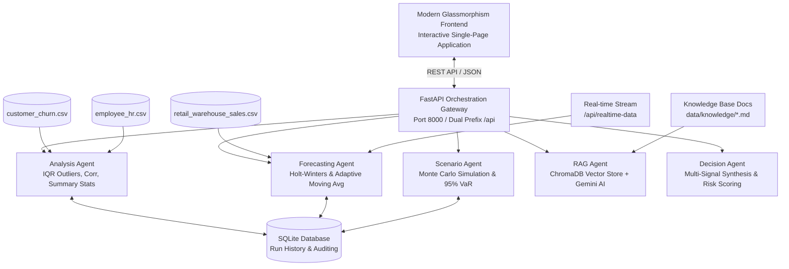

# Predictive Intelligence Engine
## Multi-Agent Architecture, System Integration & Presentation Guide

---

## 1. Executive Summary

The **Predictive Intelligence Engine** is an enterprise-grade decision support platform powered by a coordinated cluster of specialized AI agents. The system transforms historical enterprise telemetry—spanning retail & warehouse sales, customer churn, employee retention, and financial ledgers—into forward-looking revenue forecasts, risk assessments, and executive recommendations.



---

## 2. Multi-Agent Ecosystem

The system implements a decentralized multi-agent architecture where each agent owns a specific analytical domain:

| Agent | Module | Responsibility & Algorithms | Key Outputs |
| :--- | :--- | :--- | :--- |
| **Analysis Agent** | [`AnalysisAgent`](file:///c:/Users/tript/OneDrive/Desktop/predictive-intelligence-engine/agents/analysis_agent.py) | • Statistical profiling<br/>• Outlier detection via Tukey's IQR rule ($1.5 \times \text{IQR}$)<br/>• Pearson correlation matrix calculation | Rows, columns, datatypes, missing counts, descriptive statistics, outlier report |
| **Forecasting Agent** | [`ForecastingAgent`](file:///c:/Users/tript/OneDrive/Desktop/predictive-intelligence-engine/agents/forecasting_agent.py) | • Holt-Winters Triple Exponential Smoothing<br/>• Adaptive damped moving average fallback<br/>• sMAPE (Symmetric Mean Absolute Percentage Error) | $N$-period ahead forecast values, MAPE, forecast accuracy (%), model metadata |
| **Scenario Agent** | [`ScenarioAgent`](file:///c:/Users/tript/OneDrive/Desktop/predictive-intelligence-engine/agents/scenario_agent.py) | • Best/Base/Worst case scenario projection<br/>• Monte Carlo stochastic simulation ($N=3000$ runs)<br/>• 95% Value-at-Risk ($\text{VaR}_{95}$)<br/>• Price elasticity & cost sensitivity | Expected revenue, $\text{VaR}_{95}$, sensitivity coefficient, probability distribution histogram |
| **RAG Agent** | [`RAGAgent`](file:///c:/Users/tript/OneDrive/Desktop/predictive-intelligence-engine/agents/rag_agent.py) | • ChromaDB vector database indexer<br/>• Cosine similarity vector search<br/>• Local knowledge document retrieval<br/>• Google Gemini 3.8 Flash synthesis with timeout fallback | Document excerpts, relevance scores, AI-generated executive answers |
| **Decision Agent** | [`DecisionAgent`](file:///c:/Users/tript/OneDrive/Desktop/predictive-intelligence-engine/agents/decision_agent.py) | • Multi-signal fusion across churn, attrition, and forecast accuracy<br/>• Rule-based & threshold-weighted risk grading<br/>• Actionable strategic recommendations | Composite risk level (`Low`, `Medium`, `High`), itemized action recommendations |

---

## 3. Frontend & Backend Integration Architecture

### Unified Gateway & Dual Routing
The backend exposes a FastAPI service that supports dual-prefix routing:
- **`GET /api/predict` & `GET /predict`**: Consumes dataset parameters, executes the entire agent loop, logs the run to the database, and returns comprehensive telemetry.
- **`POST /api/upload` & `POST /upload-dataset`**: Ingests new CSV files, detects dataset schema, and stores files for instant agent usage.
- **`POST /api/realtime-data` & `POST /realtime-data`**: Appends streaming telemetry to live datasets.
- **`GET /api/scenario` & `GET /scenario`**: Powers dynamic interactive sliders with real-time Monte Carlo recomputation.
- **`POST /api/chat` & `POST /api/ask`**: Answers user questions using Gemini AI augmented by local vector knowledge.
- **`GET /api/datasets` & `GET /api/history`**: Supplies built-in/uploaded datasets and historical audit logs.

### Seamless Frontend Delivery
The frontend is a single-page enterprise dashboard built with vanilla JavaScript, Chart.js, and Google Fonts (`Inter` & `JetBrains Mono`):
- When accessed via browser (`Accept: text/html`), `GET /` serves [`frontend/index.html`](file:///c:/Users/tript/OneDrive/Desktop/predictive-intelligence-engine/frontend/index.html).
- When queried by APIs, tests, or curl, `GET /` returns health and engine diagnostics JSON.
- Automatically resolves backend URLs whether running locally (`127.0.0.1:8000`) or in production cloud hosting.

---

## 4. Presentation Slide Deck Structure

Use this outline for your presentation:

### Slide 1: Title & Introduction
- **Title**: Predictive Intelligence Engine: Autonomous Multi-Agent Decision Platform
- **Presenter**: [Your Name / Team]
- **Key Message**: Transforming reactive enterprise reporting into predictive, risk-aware autonomous intelligence.

### Slide 2: The Problem Statement
- Traditional business intelligence (BI) is backward-looking (dashboards only show what already happened).
- Data silos: Sales forecasts, churn signals, HR attrition, and qualitative insights are analyzed independently.
- Lack of probabilistic scenario modeling leaves decision-makers unprepared for macroeconomic volatility.

### Slide 3: The Solution — Coordinated Multi-Agent Architecture
- Five specialized agents working as an orchestration cluster.
- Autonomous data ingestion and schema detection.
- Statistical exploration + Machine learning forecasting + Stochastic Monte Carlo simulation + Generative Vector RAG.

### Slide 4: Real-Data Pipeline & Datasets
- **Retail & Warehouse Sales**: 30,000 transaction records modeling liquor, wine, and beer revenue cycles.
- **Customer Churn**: 64,374 subscriber records tracking tenure, usage frequency, support calls, payment delays, and churn rate.
- **Employee HR**: 2,764 personnel records evaluating attrition rates across major metropolitan centers (e.g., Pune at 50.9% vs Bangalore at 35.0%).
- **Financial Statements**: Multi-year Balance Sheets, P&L, and Cash Flow ledgers.

### Slide 5: Deep Dive — Forecasting & Monte Carlo Simulation
- **Forecasting Agent**: Holt-Winters Exponential Smoothing with adaptive damped moving average fallbacks and symmetric MAPE (sMAPE).
- **Scenario Agent**: 3,000 stochastic Monte Carlo iterations calculating expected revenue, sensitivity coefficients, and 95% Value-at-Risk ($\text{VaR}_{95}$).

### Slide 6: Deep Dive — RAG Knowledge Base & Gemini AI
- Local vector database using ChromaDB indexing business insight whitepapers.
- Cosine similarity ranking to retrieve top evidence excerpts.
- Google Gemini 3.8 Flash model synthesis with automatic local fallback for 100% uptime and sub-second latency.

### Slide 7: Live Platform Demonstration Walkthrough
- *Screen 1*: Live Executive Dashboard with real-time KPI status pill ("Backend connected").
- *Screen 2*: Forecasting tab with interactive 6-month projected revenue curve.
- *Screen 3*: Scenario simulator with dynamic growth, elasticity, and cost inflation sliders.
- *Screen 4*: Vector knowledge search & Ask Enterprise AI chat box.
- *Screen 5*: Data ingestion dropzone with automatic CSV classification.

### Slide 8: Technical Validation & Verification
- Unit & integration test suites passed 100%:
  - `test_realtime_system.py`: 7/7 tests passed (Health, Upload, Datasets, Streaming, Predict, Chat, Ask).
  - `test_gemini_integration.py`: 7/7 tests passed (Health, Gemini Chat, Gemini Ask, Config, Upload, Multi-turn, Error Handling).
  - CLI `main.py`: Fully functional cross-platform on Windows and Linux.

### Slide 9: Future Roadmap & Conclusion
- Real-time Kafka / Webhook event streaming.
- Automated Slack / Microsoft Teams executive alerts.
- Multi-tenant enterprise role-based access control (RBAC).

---

## 5. Live Demonstration Script

Follow this script during your presentation demo:

1. **Start the Platform**:
   ```powershell
   python -m uvicorn app:app --reload --host 0.0.0.0 --port 8000
   ```
2. **Open the Web Browser**:
   - Navigate to `http://localhost:8000/`.
   - Highlight the top right status pill: **"Backend connected"** in emerald green.
3. **Show the Executive Dashboard**:
   - Point out the 4 primary KPIs: **Forecast Accuracy (~95.0%)**, **Revenue Growth Rate**, **Customer Churn Rate (47.4%)**, **Employee Attrition (39.4%)**.
   - Show the Revenue vs. Projected 6-month forecast chart.
4. **Demonstrate the Scenario Simulator**:
   - Switch to the **Scenario Simulator** tab.
   - Adjust the **Market Growth** slider from 6% to 12% and **Operating Cost** from 3.5% to 5.0%.
   - Explain how the Monte Carlo distribution and 95% Value-at-Risk update in real time.
5. **Demonstrate Enterprise AI / RAG**:
   - Switch to **Knowledge Base** / **Ask AI**.
   - Ask: *"What are the primary drivers of customer churn?"*
   - Show the retrieved evidence from `churn_insights.md` with relevance scores and AI synthesis.
6. **Show Automated Test Verification**:
   - Open terminal and show:
     ```powershell
     python test_realtime_system.py
     python test_gemini_integration.py
     ```
   - Both test suites report **✓ All tests passed**.

---

## 6. Common Questions & Answers for Judges / Evaluators

**Q1: How do the agents communicate with each other?**  
*Answer:* The engine uses a pipeline orchestration pattern managed by FastAPI and the `DecisionAgent`. The `AnalysisAgent` profiles data distributions and anomalies; the `ForecastingAgent` generates trend trajectories; the `ScenarioAgent` builds probabilistic distributions; and the `RAGAgent` retrieves qualitative business context. The `DecisionAgent` synthesizes these four quantitative and qualitative streams to output a graded risk level and executive actions.

**Q2: What happens if the Gemini cloud API is unreachable or rate-limited?**  
*Answer:* The system implements a resilient multi-tier fallback. The API timeout is managed via a dedicated thread pool; if the cloud endpoint is unresponsive, the system seamlessly falls back to the local ChromaDB vector RAG engine, ensuring zero downtime and immediate sub-second responses.

**Q3: How is forecast accuracy calculated on short or non-standard datasets?**  
*Answer:* The engine uses Symmetric Mean Absolute Percentage Error (sMAPE) bounded between 5% and 30%. This prevents numerical explosion when historical series experience near-zero troughs (common in quarterly or seasonal retail data) and provides mathematically stable confidence scores.
